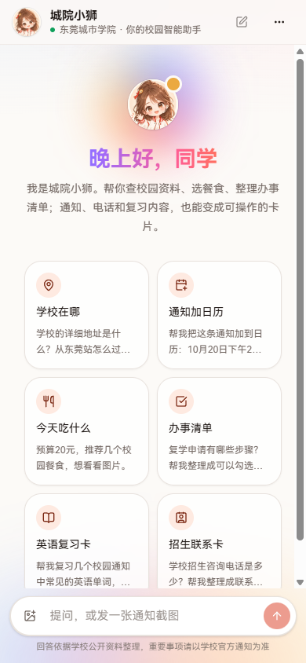
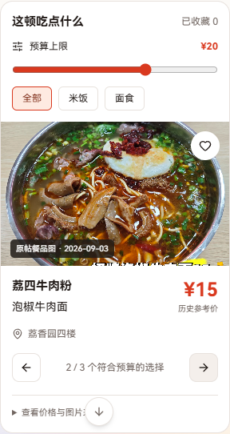
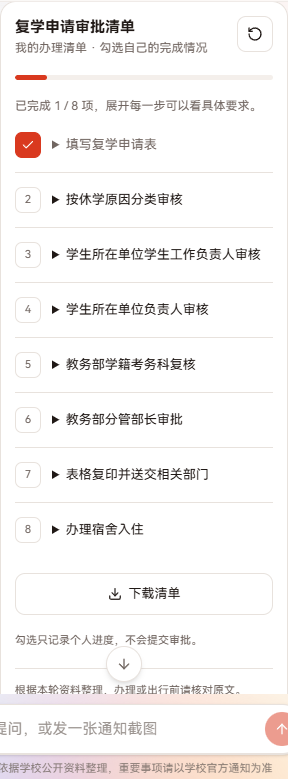
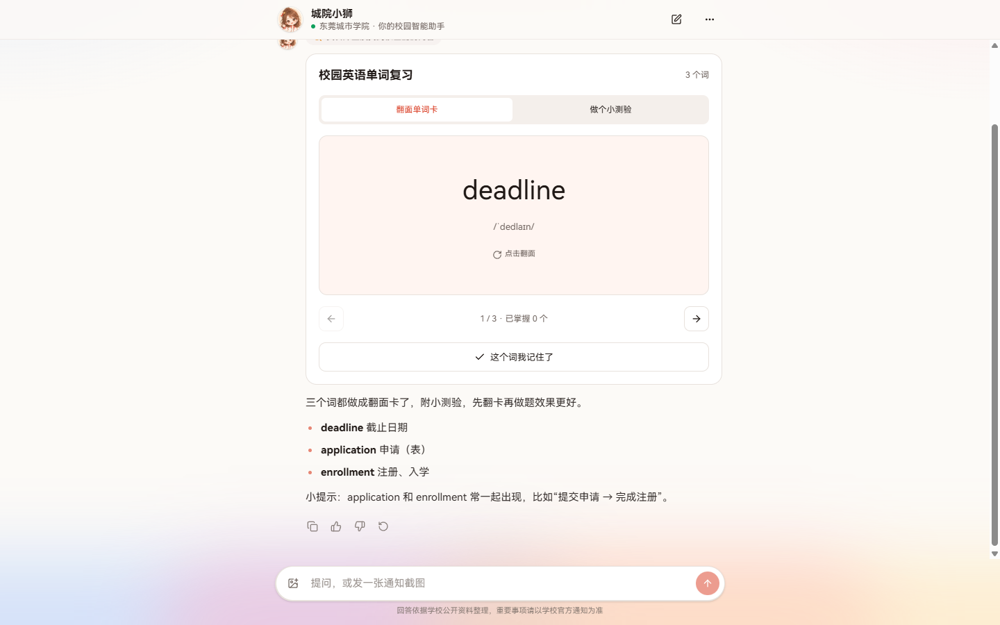
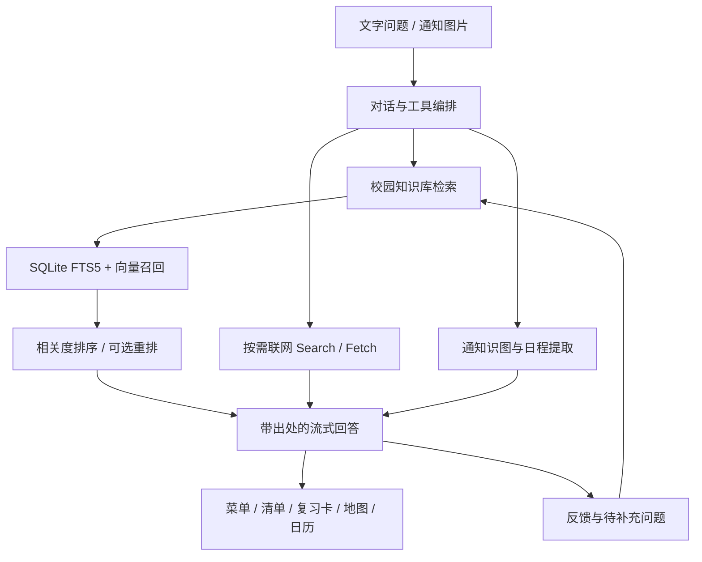

<p align="center">
  
</p>

<h1 align="center">城院小狮 · 校园智能助手</h1>

<p align="center">查校园资料、拍通知加日历，让回答变成可以操作的卡片。</p>

<p align="center">
  <a href="https://agent.example.com">在线体验</a> ·
  <a href="#快速开始">快速开始</a> ·
  <a href="web/README.md">开发与部署文档</a> ·
  <a href="#许可证与第三方内容">许可证</a>
</p>

面向东莞城市学院校园场景的智能助手，也是东莞城市学院第二届「智创全域，数启校园」智能体设计大赛参赛项目。项目把校园知识库、联网检索、通知识图和交互卡片放进同一个聊天界面，支持手机和电脑访问。

**原创应用代码采用 MIT 许可证。** 仓库附带的 MediaCrawler、外部知识资料与图片分别保留其许可或原作者权利，具体范围见[许可证与第三方内容](#许可证与第三方内容)。

## 界面预览

<table>
  <tr>
    <th>手机首页</th>
    <th>预算选餐</th>
    <th>办事清单</th>
  </tr>
  <tr>
    <td align="center"></td>
    <td align="center"></td>
    <td align="center"></td>
  </tr>
</table>

<details>
<summary>查看电脑端英语复习卡片</summary>



</details>

截图记录于 2026-10-26，用于展示界面与交互。餐品价格和照片来自历史资料，清单内容应在办理前核对原文。

## 可以做什么

| 场景 | 实现方式 |
| --- | --- |
| 校园问题问答 | 检索校园知识库，回答附数字出处，可查看摘要和原始链接；资料不足时明确说明 |
| 获取最新信息 | 按需调用 DeepSeek Search / Fetch，将联网来源和知识库来源统一编号 |
| 通知截图转日历 | 识别通知中的时间、地点和准备事项，生成日程卡片，导出 `.ics` 供用户导入日历 |
| 今天吃什么 | 展示带图片、历史价格、预算筛选与收藏的餐食菜单 |
| 整理办事流程 | 将有资料依据的流程变成可勾选、可下载的清单 |
| 复习和联系信息 | 展示英语翻面卡与小测验、考试备忘和联系卡 |
| 查地点与导航 | 接入高德 JS API 2.0，查询真实 POI，在确认目的地后打开高德导航 |
| 管理与补充资料 | `/admin` 查看提问、反馈、待补充问题和知识库，支持重新导入资料 |

界面支持深色模式、流式回复、停止生成、对话本地保存、图片压缩、微信内打开引导，以及添加到手机主屏幕。服务端包含请求限流和排队控制。

## 技术栈与处理流程

| 部分 | 技术 |
| --- | --- |
| 应用框架 | Next.js 16、React 19、TypeScript |
| 界面 | Tailwind CSS 4、shadcn/ui、Base UI |
| 模型与工具 | Vercel AI SDK 7、OpenAI 兼容接口、DeepSeek Search / Fetch |
| 知识检索 | Node.js 内置 SQLite、FTS5、向量召回、可选重排模型 |
| 地图 | 高德地图 JS API 2.0、POI 查询、服务端安全代理 |
| 部署 | Docker Compose + Caddy，或 Node.js + systemd + Nginx |



## 快速开始

运行环境：**Node.js 24**、**pnpm 11.22.0**。应用使用 Node.js 内置 SQLite，需要在 Node.js 服务端运行。

```bash
git clone https://github.com/fanmi12/Campus-Intelligent-Agent.git
cd Campus-Intelligent-Agent/web
pnpm install --frozen-lockfile
```

复制配置文件。PowerShell：

```powershell
Copy-Item .env.example .env.local
```

macOS / Linux：

```bash
cp .env.example .env.local
```

启动开发服务：

```bash
pnpm dev
```

打开 [http://localhost:3000](http://localhost:3000)。**不填写 `LLM_API_KEY` 即可进入演示模式**，先体验聊天布局和交互；演示回复不调用真实大模型。开发环境还可访问 `/preview/map` 查看七类交互卡片。

首次启动会在后台从 `web/knowledge/` 同步知识库，并在 `web/data/` 创建本地数据库。未配置嵌入和重排模型时，知识检索使用关键词召回；配置后可增加语义检索与精排。已有数据库和历史聊天记录不随仓库分发。

## 配置真实模型与地图

编辑 `web/.env.local`，完整参数与示例见 [`web/.env.example`](web/.env.example)。

| 功能 | 主要环境变量 | 未配置时 |
| --- | --- | --- |
| 对话 | `LLM_BASE_URL`、`LLM_API_KEY`、`LLM_MODEL` | 使用演示回复 |
| 通知识图 | `VISION_MODEL`；可另设 `VISION_BASE_URL`、`VISION_API_KEY` | 不调用真实识图能力 |
| 语义检索 | `EMBEDDING_BASE_URL`、`EMBEDDING_API_KEY`、`EMBEDDING_MODEL` | 使用关键词检索 |
| 结果重排 | `RERANK_MODEL`；可另设 `RERANK_BASE_URL`、`RERANK_API_KEY` | 使用召回与粗排结果 |
| 实时联网 | `WEB_SEARCH_ENABLED`、`DEEPSEEK_SEARCH_API_KEY` | 无有效配置时不调用联网工具 |
| 高德地图 | `AMAP_JS_API_KEY`、`AMAP_SECURITY_JSCODE` | 提示地图未配置，提供高德搜索入口 |
| 管理后台 | `ADMIN_PASSWORD` | 后台关闭 |

识图默认沿用对话服务，重排默认沿用嵌入服务。对话接口指向 DeepSeek 官方时，联网工具可复用 `LLM_API_KEY`；其他对话服务商需要单独配置 `DEEPSEEK_SEARCH_API_KEY`。可用 `WEB_SEARCH_ENABLED=false` 关闭联网。

模型 ID 以服务商实际提供的接口为准；切换服务商时一并检查 `LLM_EXTRA_BODY`。外部模型、联网工具和地图需使用自己的服务配置；开启语义检索后，首次入库也会请求嵌入接口。

## 知识库与数据范围

[`web/knowledge/`](web/knowledge/README.md) 保存整理后的 Markdown 资料，包括学校概况、校园设施、官网页面、附件转写与餐饮资料。每份资料可标注标题、分类、原始出处和更新时间，检索后按片段交给模型。

- 官网资料目录包含 **7,381 个 Markdown 文件**。附件转写单独存放，入库时替换相应的附件占位内容；不能把两者直接相加当作不同来源页面。
- 原始帖子数、评论数、清洗后的文档数和切分后的知识片段数属于不同统计口径。原始社媒采集包与过程报表保留在本地，未随本仓库上传。
- 餐品图片、价格与评价保留历史来源，不表示实时菜单、当前营业状态或实地核验结果。
- 新增资料按[知识库格式说明](web/knowledge/README.md)填写 `source` 和 `updated`，避免把模型生成内容当作原始证据。

更新资料后，可重启服务、在管理后台重新导入，或在 `web/` 执行：

```bash
pnpm kb:ingest
```

官网导入、附件转写和检索评测的详细用法见 [`web/README.md`](web/README.md)。采集工具说明见 [`crawlers/README.md`](crawlers/README.md)；采集流程独立于应用运行，启动网页不需要执行爬虫。

## 常用开发命令

以下命令均在 `web/` 目录运行。

| 命令 | 用途 |
| --- | --- |
| `pnpm dev` | 启动开发服务 |
| `pnpm lint` | 检查代码规范 |
| `pnpm typecheck` | 检查 TypeScript 类型 |
| `pnpm build` / `pnpm start` | 构建 / 启动生产服务 |
| `pnpm test:web-search` | 联网工具协议回归检查 |
| `pnpm test:rich-ui` | 交互卡片与工具协议检查 |
| `pnpm kb:ingest` | 同步知识库与索引 |
| `pnpm kb:food:validate` | 使用隔离数据库验证餐饮知识库 |
| `pnpm kb:eval` | 运行检索评测 |

`pnpm smoke:web-search` 会实际调用外部联网服务，需先配置服务商密钥。

## 部署

推荐使用仓库提供的 Docker Compose 配置。在 `web/` 中将 `.env.example` 复制为 `.env`，填写服务配置，并添加 `DOMAIN=你的域名`。将域名解析到服务器，放行 80 和 443 端口后运行：

```bash
docker compose up -d --build
```

Caddy 自动管理 HTTPS，数据库存入 `app_data` 卷，知识库通过只读目录挂载。备份时同时保留数据库、知识库和部署环境配置。首次启动后的知识库同步进度可通过 `docker compose logs -f app` 查看。

生产构建、本机直启、Nginx 与 systemd 配置详见 [`web/README.md`](web/README.md) 和 [`web/deploy/`](web/deploy/)。仓库根目录的 `scripts/*campus*.py` 包含本项目现有服务器的维护脚本，复用到其他服务器前需修改目标配置。

## 目录结构

```text
Campus-Intelligent-Agent/
├── web/
│   ├── src/app/             聊天首页、管理后台与 API
│   ├── src/components/      聊天组件和交互卡片
│   ├── src/lib/server/      模型、检索、SQLite 与请求队列
│   ├── knowledge/           整理后的知识库
│   ├── public/              头像、餐品图片与静态资源
│   ├── scripts/             入库、评测与协议检查
│   ├── deploy/              Nginx / systemd 配置
│   └── .env.example         环境配置模板
├── scripts/                 采集、整理、核验与维护脚本
├── crawlers/                采集工具与上游版本记录
├── docs/images/             README 界面截图
├── LICENSE                  原创代码的 MIT 许可证
└── THIRD_PARTY_NOTICES.md    第三方代码与资料的许可范围
```

`.env`、密钥、浏览器登录态、依赖目录、构建缓存、SQLite 数据库，以及根目录的 `data/`、`output/`、`outputs/` 均由 [`.gitignore`](.gitignore) 排除，保留在本地。

## 参与改进

欢迎通过 [Issues](https://github.com/fanmi12/Campus-Intelligent-Agent/issues) 提交问题或建议，也欢迎提交 Pull Request。界面问题请附复现步骤、浏览器和截图；资料纠错请附原始出处与日期。提交代码前运行与改动相关的规范、类型或协议检查。

## 许可证与第三方内容

本项目原创应用代码、原创维护脚本和项目文档采用 [MIT License](LICENSE)，版权归 `fanmi12` 及相应贡献者所有。这个许可不覆盖下列第三方内容：

| 内容 | 许可或权利范围 |
| --- | --- |
| [`crawlers/MediaCrawler/`](crawlers/MediaCrawler/) | 来源为 [NanmiCoder/MediaCrawler](https://github.com/NanmiCoder/MediaCrawler)，保留上游的[非商业学习许可证 1.1](crawlers/MediaCrawler/LICENSE)及署名 |
| [`crawlers/MediaCrawler/webui/`](crawlers/MediaCrawler/webui/) | 子目录另附 [GPL-3.0](crawlers/MediaCrawler/webui/LICENSE)，继续保留其原有许可文件 |
| 校园知识库、引用的通知与附件转写 | 来源内容的权利归原作者或发布机构，不因本仓库公开而改为 MIT |
| 餐品照片、社媒资料与界面截图中的外部内容 | 权利归原作者；出处可从资料文件与餐食目录追溯，未额外授予商业使用或再许可权 |
| 通过包管理器安装的依赖 | 各自遵循上游许可证 |

完整来源与适用范围见 [`THIRD_PARTY_NOTICES.md`](THIRD_PARTY_NOTICES.md)。
